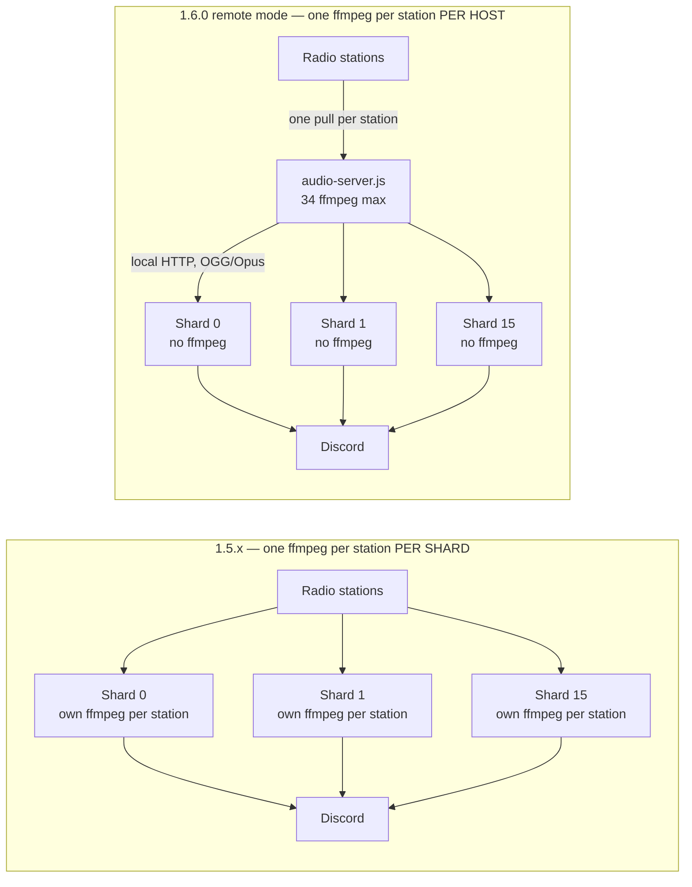
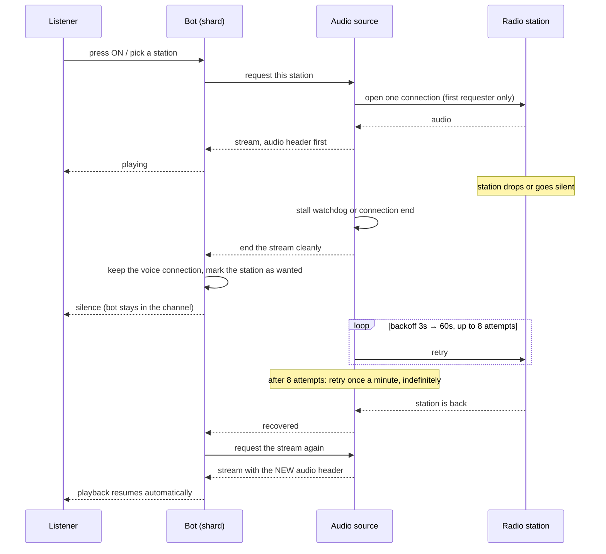

# Changelog

All notable changes to this project are documented in this file.

The format follows [Keep a Changelog](https://keepachangelog.com/en/1.1.0/) and this project
adheres to [Semantic Versioning](https://semver.org/spec/v2.0.0.html).

> **On the reconstructed history.** Releases from `1.0.0` to `1.4.5` predate this changelog. They
> were reconstructed from the repository itself: git tags, the history of the `version` field in
> `package.json` (`git log -p -- package.json`), and commit messages on `main`. Each release is
> dated by the commit that set its version number. Tags exist for `1.1.0`, `1.1.1`, `1.3.1`,
> `1.3.2`, `1.3.4`, `1.3.5`, `1.4.0`, `1.4.3`, `1.4.4` and `1.4.5`; the remaining versions are known
> only from `package.json`. Where the history gives no version at all, entries are grouped under
> "Earlier changes (unversioned)". No version number or date in this file was invented.

---

## [1.6.0] - 2026-10-31

Audio delivery was moved out of the shard processes. A station is now fetched and encoded **once
per host** instead of once per shard, and the broadcaster gained the lifecycle management it was
missing — stall detection, a bounded retry policy, reference counting, and real teardown.

Merged to `main` as pull request #7 (`c73a21c`).

### Added

- **Standalone audio server** (`audio-server.js`). A separate process that pulls each radio station
  once, encodes it to OGG/Opus, and serves it to every shard over local HTTP. Binds `127.0.0.1`
  only and requires a bearer token on every request.
- **Two audio modes, selected with `AUDIO_MODE`:**
  - `embedded` (default) — the broadcaster runs inside the bot, exactly as before. A plain
    `npm start` with no new configuration behaves identically to 1.5.x.
  - `remote` — the bot pulls ready-made streams from the audio server and spawns **no ffmpeg at
    all**.
  Both modes run the same broadcaster code; only the source of the audio bytes differs.
- **Per-shard rollout with `AUDIO_REMOTE_SHARDS`.** A comma-separated list of shard ids that should
  use the audio server while every other shard stays embedded, so remote mode can be adopted one
  shard at a time with the rest acting as a control group. Empty or unset means all shards.
- **New environment variables** (all documented in `.env.example`):

  | Variable | Default | Purpose |
  |---|---|---|
  | `AUDIO_MODE` | `embedded` | `embedded` or `remote` |
  | `AUDIO_REMOTE_SHARDS` | *(empty = all)* | Shard ids that go remote |
  | `AUDIO_SERVER_URL` | `http://127.0.0.1:3040` | Where the bot pulls streams from |
  | `AUDIO_SERVER_PORT` | `3040` | Port the audio server listens on |
  | `AUDIO_SERVER_TOKEN` | `change_me` | Bearer token required on every request |
  | `AUDIO_BITRATE` | `128k` | Opus encoding bitrate |
  | `AUDIO_STATION_IDLE_MS` | `600000` | How long a station stays warm after its last listener |

- **Monitoring endpoints on the audio server** (all require the bearer token):
  - `GET /health` — per-station state, listener count, age of the last received audio, ffmpeg PID,
    retry attempts, plus totals.
  - `GET /stations` — the servable station allowlist.
  - `GET /stream?url=…` — the audio itself, with the OGG header replayed to every new client.
- **Richer live statistics.** The dashboard socket now also reports the audio mode, active broadcast
  count, real listener totals, and whether the audio server is reachable. `/status` in Discord shows
  the same. Broadcasts that are failed or idle are now included in statistics instead of being
  hidden.
- **ffmpeg counting scripts** — `scripts/count-ffmpeg.sh` (Linux/macOS) and
  `scripts/count-ffmpeg.ps1` (Windows PowerShell), for confirming the process count dropped.
- **Stall detection.** Each broadcast tracks when it last received audio; 15 seconds of silence on
  an open connection is treated as a drop and triggers reconnection.
- **Bounded retry policy with recovery.** Reconnection uses exponential backoff with jitter from 3
  to 60 seconds, up to 8 attempts, after which the station enters a failed state and is retried once
  a minute until it returns — per station, never per server.
- **A second pm2 application.** `ecosystem.config.js` now defines `quran-audio` (the audio server,
  started first) alongside `quran` (the bot), both with their working directory pinned and a memory
  ceiling.
- **PostgreSQL support** as a database backend, alongside the existing JSON, MongoDB, SQLite and
  MySQL options.
- **Shard status view** — a new component showing per-shard health.
- **Sharding manager improvements** — clearer per-shard logging and a graceful shutdown path that
  stops shards in order instead of killing the process.
- **Automated test suite** under `tests/`: an end-to-end audio server harness against a real
  station, plus unit coverage for the broadcaster and the recovery bookkeeping. No test touches
  Discord or the bot token.
- **Documentation** — `docs/architecture.md`, `docs/audio-pipeline.md`, `docs/startup-restore.md`,
  `docs/audio-source-contract.md`, `docs/test-bot-checklist.md`, and an engineering analysis in
  `docs/AUDIO_REPORT.md`.

### Changed

- **One ffmpeg per station per host instead of one per shard.** With 16 shards and 34 stations, the
  worst case was up to **544** ffmpeg processes and 544 upstream connections on a single machine.
  In remote mode the ceiling is **34** — one per station — regardless of shard count, with a
  proportional reduction in CPU, memory and inbound bandwidth.
- The audio source is now attached to the bot client rather than held in module scope, which is what
  makes it survive a hot reload.
- Reconnection is now owned by the station, not by each server waiting on it. Hundreds of servers on
  one failing station now produce one retry stream rather than hundreds.
- A station with no listeners is now shut down after an idle period instead of running forever.
- The Opus encoding bitrate is configurable (`AUDIO_BITRATE`); the default is unchanged at `128k`.

### Fixed

- **Stations could go permanently silent with no warning.** If a radio host stopped sending audio
  while keeping the connection open, nothing noticed: the connection timeout only covered the
  initial response, ffmpeg kept waiting for input, and no error was ever raised. Servers showed the
  bot as connected and playing while hearing nothing until the bot was restarted. A stall watchdog
  now detects this and reconnects.
- **Audio went silent after every reconnect.** When a station reconnected, the encoder began a new
  audio stream with a new identifier, which the Discord audio decoder silently discards — again with
  no error, so playback never recovered. Listeners are now disconnected cleanly on a drop so
  playback restarts on the new stream, at the cost of about a second of silence.
- **Recovery stopped working after a long outage.** If a station stayed down for longer than the
  idle period, its retry timers were cancelled while servers were still waiting for it, so audio
  never came back even once the station recovered. Stations with servers waiting on them are now
  kept alive and keep retrying.
- **`/refresh` leaked ffmpeg processes.** Each hot reload built a second broadcaster and left the
  previous one's ffmpeg processes running and unreachable, so the process count doubled every time
  while appearing to work. The safety check meant to prevent this could never function.
- **Broadcasts were never stopped.** Nothing in the bot ever shut a station down, so every shard
  drifted toward holding all stations open permanently, even with nobody listening.
- **Servers waiting for a station could be stranded.** Pressing OFF, rejoining a voice channel, or
  removing the bot from a server left stale bookkeeping that kept a station alive forever and
  retrying for nobody.
- **A station that was down when a server first tried to play it never recovered**, because the
  attempt was discarded instead of being retried.
- **The very first server to use a station got no audio** in some cases, because the stream was
  offered before the audio header had been captured.
- **Rapid station switching could start the same station twice**, leaving an orphaned encoder and
  upstream connection that nothing could stop, and in some cases garbled audio.
- **The audio server loaded no configuration when started from another directory.** It looked for
  `.env` relative to the current working directory, and pm2 sets none by default, so it could come
  up with no token and the wrong bitrate while the bot used the real values — rejecting every
  request with `401`. It now loads `.env` from the repository root, and pm2 pins the working
  directory.
- **Audio header detection could be fooled by the audio itself.** The header was located by
  scanning for a 4-byte marker that can legitimately occur inside audio data, which could cache a
  truncated header and break every later listener. Headers are now identified by parsing real
  stream structure.
- **Stopping a station could leave its bookkeeping inconsistent**, so the cleanup that frees
  resources never ran.
- **Statistics hid the problems.** Failed and orphaned broadcasts were omitted from the counts, so
  none of the above was visible from `/status` or the dashboard.

### Security

- The audio server binds to `127.0.0.1` only and requires `Authorization: Bearer <AUDIO_SERVER_TOKEN>`
  on **every** request, including `/health`. It refuses to run without a token and warns loudly at
  startup if the token is still the `change_me` placeholder.
- `/stream` serves only URLs on an allowlist built from the configured station list. Any other URL is
  rejected with `403`, so the port cannot be used as an open proxy.
- `.env` remains ignored by git and has never been committed; only `.env.example` with placeholder
  values is tracked.

### Removed

- The old in-bot broadcaster is superseded by the shared audio engine under `src/audio/`.
- The non-functional hot-reload safety check for the broadcaster was removed, together with the
  machinery supporting it.

### Before and after



Worst case went from `16 shards × 34 stations = 544` encoders to `34`.

### Playback and recovery



### Upgrading from 1.5.x

Embedded mode needs **no configuration changes** — `npm start` behaves as before.

To adopt remote mode:

1. Copy the new audio variables from `.env.example` into your `.env`.
2. Generate a real `AUDIO_SERVER_TOKEN` and set the same value for both processes, which share one
   `.env`:
   ```bash
   node -e "console.log(require('crypto').randomBytes(32).toString('hex'))"
   ```
   Leaving it as `change_me` is refused in spirit: the server starts but warns, and any mismatch
   between the two processes shows up as `401` on every request.
3. Set `AUDIO_MODE=remote`. Optionally set `AUDIO_REMOTE_SHARDS=0` first to move only shard 0.
4. Because `ecosystem.config.js` now defines two applications, pm2 must re-read it:
   ```bash
   pm2 delete ecosystem.config.js
   pm2 start ecosystem.config.js
   ```
   A plain `pm2 restart` will not pick up the new `quran-audio` application. Start the audio server
   before, or at the same time as, the bot — a bot that starts while the audio server is down keeps
   its voice connections and resumes on its own once the server appears.
5. Confirm with `scripts/count-ffmpeg.sh` or `scripts/count-ffmpeg.ps1`: the shard processes should
   show **0**, and the audio-server host at most one per station in use.

**Rollback** is one variable: set `AUDIO_MODE=embedded` and restart the bot. The embedded path is
unchanged and fully supported, so it is safe to go back at any point. To narrow a partial rollout
instead, shorten `AUDIO_REMOTE_SHARDS` and restart.

### Known issues

Carried over from 1.5.x and deliberately **not** addressed in this release — all three are analysed
in `docs/AUDIO_REPORT.md`:

- **Audio restarts into empty voice channels** (§C5). Playback stops when the last listener leaves,
  but a retry about five seconds later starts it again and it then plays to an empty channel
  indefinitely. The bot therefore uses CPU and bandwidth for servers nobody is listening to. The
  `idleRadio` figure on the dashboard measures how much.
- **A restart re-enables radio in servers that turned it off** (§C6). Startup restore ignores the
  stored enabled flag and overwrites it to enabled, so a deliberate OFF does not survive a restart.
- **Lag handling can corrupt a single listener's audio** (§M1). A listener that falls more than
  64 KB behind has data dropped mid-frame rather than at a frame boundary, which can cause a brief
  glitch or dropout for that server only.

Also note that `max_memory_restart` in `ecosystem.config.js` applies to the pm2-managed processes,
not to individual shards forked by the sharding manager, so it will not catch a leak inside a single
shard.

---

## [1.5.0] - 2026-03-15

A complete rework of the prayer-time system, plus sharding.

### Added

- **Prayer times from the Aladhan API.** Replaced the previous calculation library with the
  [Aladhan API](https://api.aladhan.com), using latitude/longitude instead of city-name lookup for
  better accuracy.
- **Country → city selection.** Setup now asks for a country and then a city, storing the city's
  timezone and coordinates. Countries with more than 25 cities get a "more" button to page through
  the rest, working around Discord's menu limit. Yemen was added and every country's city list
  expanded.
- **Exact adhan scheduling.** Each prayer is scheduled to the millisecond instead of being polled
  every minute, and the next prayer is scheduled automatically. If the day's prayers have passed,
  the following day's Fajr is scheduled, including across a month boundary.
- **Two-layer prayer cache.** Monthly prayer calendars are cached in memory and in the database,
  keyed by location rather than by server, so every server in the same city shares one lookup.
  Entries older than five days refresh automatically, and old months are purged at startup.
- **Duplicate adhan protection.** Each prayer announcement is recorded, so a restart or a race
  cannot send the same adhan twice.
- **Prayer channels are restored at startup**, alongside radio and adhkar.
- **Human-readable countdowns** in the adhan test message, in Arabic.
- **Sharding.** The bot can run under a sharding manager, with a separate MongoDB entry point and
  improved error handling and shard logging.

### Fixed

- Adhkar and prayer setup were silently skipped on servers that had no radio channel configured.
- A startup crash caused by a missing prayer location data file.
- Audio fetching broke on a dependency that could no longer be loaded; replaced with a compatible
  HTTP client.
- ffmpeg was not found on Windows; the bundled binary is now registered at startup.
- The prayer-times image test used an outdated interface and failed.
- Prayer could be switched on before a location was fully chosen.
- Duplicate startup initialisation was removed.

### Changed

- The prayer control panel was restructured: country and city are shown separately, roles are always
  visible, and button labels were shortened.
- Changing country now clears the previously selected city instead of leaving a mismatched pair.
- Prayer location data was restructured from a flat list into per-country entries with coordinates
  and timezones.

---

## [1.4.5] - 2024-09-30

### Fixed
- Radio station caching corrected, so servers no longer resume on the wrong station.

## [1.4.4] - 2024-09-23

### Fixed
- Setup on a newly added server stored its configuration correctly.
- Prayer-times image line spacing corrected.

## [1.4.3] - 2024-09-23

### Fixed
- The back and random station buttons selected the wrong station in some cases.

## [1.4.2] - 2024-09-23

### Changed
- Reworked the setup flow.

## [1.4.1] - 2024-09-23

### Fixed
- Servers configured on older versions kept playing an outdated station URL.

## [1.4.0] - 2024-09-23

Reconstructed from the release note in commit `c39e4a1`.

### Added
- **Adhkar system** — a channel can be configured to post adhkar automatically, with control over
  the channel, send interval, mention role, category and embed style.
- **Next, previous and random station buttons** on the radio control panel.
- New stations: Sheikh Mohamed Rifat, Makkah Haram channel, and lecture channels for Omar Abdel Kafy
  and Dr. Mabrouk Attia.
- Arabic font registration for generated images.

### Removed
- The "إذاعة ابراهيم الدوسري" station.

---

## [1.3.5] - 2024-08-26

### Changed
- Radio control panel adjustments.

## [1.3.4] - 2024-08-16

### Changed
- Bot activity status text updated.

## [1.3.3] - 2024-08-16

### Fixed
- Database handling updated so servers saved with an older station format keep working.

## [1.3.2] - 2024-07-27

### Fixed
- Changing a server's radio channel saved the new channel correctly.

## [1.3.1] - 2024-07-27

### Added
- Permission checks on radio commands.

### Changed
- Radio channel setup moved from a modal to a selection menu.

## [1.3.0] - 2024-07-26

### Changed
- Radio channel setup reworked into a selection menu.

---

## [1.2.0] - 2024-07-16

### Added
- A status button in the help command.

### Fixed
- Channel and message fetching errors.

## [1.1.1] - 2024-07-11

### Added
- A help command.

### Fixed
- Moving the bot to another voice channel no longer reset playback to the default station.
- Radio channel setup corrections.

## [1.1.0] - 2024-07-07

### Added
- Station artwork on the radio panel.
- A version checker.

### Fixed
- Radio stopping shortly after it started playing.

---

## [1.0.0] - 2024-07-03

First version carrying a version number.

### Changed
- Pinned discord.js to a known-good release.

### Fixed
- Errors when a server was no longer reachable.
- User counting corrected.

---

## Earlier changes (unversioned)

Reconstructed from git history between **2024-05-16** and **2024-07-03**, before the project carried
a version number in `package.json`. Summarised rather than listed commit by commit.

### Added
- The initial Quran radio bot: voice-channel playback, a station list, and a setup and control panel.
- A caching layer for server configuration.
- A command, event and component handler framework.
- Additional stations, including Yasser Al-Dosari.
- Bot activity status showing what is playing.
- Setup and start helper scripts, and the MIT licence.

### Fixed
- Playback stopping unexpectedly, and failing to restart after an error.
- Moving the bot between voice channels.
- Missing-access and unknown-channel errors from Discord.
- Language file loading.
- Control panel behaviour on servers that had never run setup.
- Login timing on startup.
