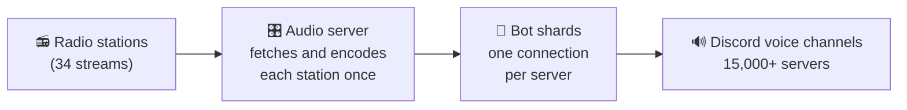
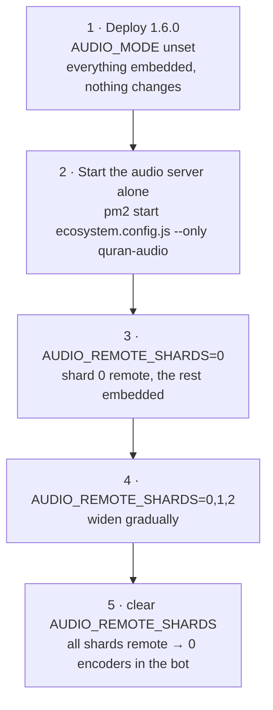

# Quran Radio

## Discord bot Quran Radio 📻🥰

[](https://discord.com/oauth2/authorize?client_id=1110669204295790703)

A Discord bot that plays Quran radio in voice channels around the clock, posts morning and evening
adhkar, and announces the adhan at the right time for each server's own location.

- **24/7 Quran radio** in any voice channel, with **34 stations** — reciters, Makkah and Madinah
  haram channels, tafseer, adhkar and lectures — switchable from a control panel without leaving
  the channel.
- **Morning and evening adhkar**, posted automatically on a schedule you choose, as rendered Arabic
  images.
- **Adhan at prayer times**, calculated per server from its configured city, with prayer-time cards.
- **Arabic and English**, selectable per server.
- Trusted by **15,000+ servers** and **3M+ users**.
- Live status dashboard: <https://quran.devxor.team/>

> **Version 1.6.0** — see [CHANGELOG.md](./CHANGELOG.md) for what changed. 1.6.0 moved audio
> encoding out of the shard processes, so large deployments run one encoder per station per machine
> instead of one per shard.

---

## How it works



A station is fetched and encoded **once**, then the same audio is shared with every Discord server
listening to it. Without that sharing, 500 servers on one station would mean 500 downloads and 500
encoders.

### Embedded vs remote mode

The same audio engine runs in both modes; only where the encoding happens changes.

| | `AUDIO_MODE=embedded` *(default)* | `AUDIO_MODE=remote` |
|---|---|---|
| Who encodes | The bot process itself | A separate `audio-server.js` process |
| ffmpeg in the bot | Yes | **None** |
| Encoders at worst | One per station **per bot process** | One per station **per machine** |
| Setup needed | None — just `npm start` | Run a second process, share a token |
| Best for | A self-hosted bot in one process | Many shards, or several bot processes |

**Choose embedded** if you run a single bot process. It is the default, needs no configuration, and
nothing in this README is required to make it work.

**Choose remote** once you run several shards. With 16 shards and 34 stations, embedded mode can
reach 544 encoders on one machine; remote mode caps it at 34.

---

## Requirements

- **Node.js 18 or newer** (`engines.node` is `>=18.0.0`). Node 18+ is required for the built-in
  `fetch` used by the test harness.
- **A database.** The default needs no setup:
  - **JSON file** (default, `database/database.json`) — zero configuration, fine for one process.
  - **MongoDB** — recommended for sharded deployments, via `node bot.js`.
  - **SQLite**, **MySQL**, **PostgreSQL** — also supported by the storage layer. Their drivers ship
    with the `good.db` dependency, so no extra install is needed.
- **ffmpeg** — bundled automatically through `ffmpeg-static`; you do not need to install it. Set
  `FFMPEG_PATH` only if you want to use your own build.
- **OS** — works on Windows, Linux and macOS. The repository includes `start.vbs` / `stop.vbs`
  helpers that run pm2 on Windows without opening a console window.
- **pm2** — optional, and only needed for remote mode or production process management.

---

## Installation

```bash
git clone https://github.com/omar00050/quran_radio.git
cd quran_radio
npm install
```

Then create your configuration:

```bash
# Linux / macOS
cp .env.example .env

# Windows PowerShell
Copy-Item .env.example .env
```

Open `.env` and set at least `token` (your Discord bot token). Every variable is described in
[Configuration](#configuration).

> Values go in `.env`, not on the command line. `VAR=value command` does not work in PowerShell, so
> this README never uses it — keeping everything in `.env` means the same commands work on every
> platform.

### Running — embedded mode (recommended to start)

One process, no extra setup:

```bash
npm start
```

That is the whole thing. `npm start` runs `node index`, which uses the JSON database. On startup the
bot logs the audio mode it chose:

```
Audio mode: embedded — AUDIO_MODE=embedded
```

Other entry points:

| Command | What it runs |
|---|---|
| `npm start` or `node index.js` | One process, JSON database |
| `node bot.js` | One process, MongoDB |
| `node shard.js` | Sharding manager — forks one `index.js` per shard |
| `node audio-server.js` | The standalone audio server (remote mode only) |

### Running — remote mode with pm2

**1. Generate a strong token.** Both processes read the same `.env`, so one value serves both:

```bash
node -e "console.log(require('crypto').randomBytes(32).toString('hex'))"
```

Put the result in `.env` as `AUDIO_SERVER_TOKEN`. Do not leave it as `change_me` — the audio server
warns at startup if you do.

**2. Switch the bot to remote mode** in `.env`:

```
AUDIO_MODE=remote
AUDIO_SERVER_TOKEN=<the value you just generated>
```

**3. Start both applications.** `ecosystem.config.js` defines `quran-audio` (the audio server, listed
first so it comes up before the bot) and `quran` (the sharding manager):

```bash
pm2 start ecosystem.config.js
pm2 logs
```

If you are upgrading from 1.5.x, pm2 is still holding the old single-application definition. It must
re-read the file:

```bash
pm2 delete ecosystem.config.js
pm2 start ecosystem.config.js
```

A plain `pm2 restart` will not create the new `quran-audio` application.

**4. Check it worked:**

```bash
# Linux / macOS
bash scripts/count-ffmpeg.sh

# Windows PowerShell
powershell -File scripts/count-ffmpeg.ps1
```

The bot processes should report **0** encoders, and the audio-server machine at most one per station
currently in use.

> Starting the bot before the audio server is safe. It keeps its voice connections, retries in the
> background, and resumes playback on its own once the server is up.

---

## Configuration

Every variable lives in `.env`. The file is ignored by git — never commit it, and never share its
contents. `.env.example` is the template and contains only placeholders.

| Variable | Default | Required | Description |
|---|---|---|---|
| `token` | — | **Yes** | Discord bot token |
| `mongodb_uri` | — | For `bot.js` | MongoDB connection string |
| `postgres_uri` | — | No | PostgreSQL connection string |
| `RadioAudioUrl` | — | No | Default station used when a server has none set |
| `SOCKET_PORT` | `3030` | No | Port for the live-status socket the dashboard reads |
| `DASHBOARD_ORIGIN` | `*` | No | Allowed origin for the dashboard socket |
| `ERROR_LOGS` | — | No | Discord webhook URL for error reports |
| `WARN_LOGS` | — | No | Discord webhook URL for warnings |
| `testMode` | — | No | Set to any value to enable test mode |
| `AUDIO_MODE` | `embedded` | No | `embedded` or `remote` |
| `AUDIO_REMOTE_SHARDS` | *(empty = all shards)* | No | Comma-separated shard ids that use the audio server |
| `AUDIO_SERVER_URL` | `http://127.0.0.1:3040` | Remote mode | Where the bot pulls streams from |
| `AUDIO_SERVER_PORT` | `3040` | Remote mode | Port the audio server listens on (binds `127.0.0.1` only) |
| `AUDIO_SERVER_TOKEN` | `change_me` | Remote mode | Bearer token required on every audio-server request |
| `AUDIO_BITRATE` | `128k` | No | Opus encoding bitrate |
| `AUDIO_STATION_IDLE_MS` | `600000` | No | How long a station stays warm after its last listener (10 minutes) |
| `FFMPEG_PATH` | bundled binary | No | Override the ffmpeg executable |

Timing values that are **not** configurable, for reference: a stalled station is detected after 15
seconds of silence; reconnection backs off from 3 to 60 seconds over up to 8 attempts, then retries
once a minute indefinitely.

Non-secret settings — command prefix (`+`), client id, owner ids and branding — live in
`config.json`.

---

## Rolling out remote mode gradually

`AUDIO_REMOTE_SHARDS` lets you move shards to the audio server a few at a time, so the rest keep
working exactly as before and act as a control group.

**Read the value carefully:**

- `AUDIO_REMOTE_SHARDS=0` means **shard 0 uses the audio server**. It does **not** mean "no shards".
- `AUDIO_REMOTE_SHARDS=0,1,2` means shards 0, 1 and 2 go remote; all others stay embedded.
- Leaving it **empty or unset** means **every** shard goes remote.
- It is ignored entirely when `AUDIO_MODE=embedded`, and on an unsharded run (`npm start`) where
  there are no shards to split.

A typical rollout:



Each shard logs which mode it chose and why, for example
`Audio mode: embedded — shard 3 not in AUDIO_REMOTE_SHARDS=0`.

**To roll back**, set `AUDIO_MODE=embedded` and restart the bot. That is the switch that turns
remote mode off — clearing `AUDIO_REMOTE_SHARDS` does the opposite and sends *every* shard remote.
To narrow a partial rollout instead, shorten the list and restart.

---

## Monitoring

**Dashboard** — <https://quran.devxor.team/> shows servers, listeners, per-shard health and which
stations are being played. It reads the live-status socket on `SOCKET_PORT`.

**Audio server health** — every request needs the bearer token:

```bash
# Linux / macOS
curl -s -H "Authorization: Bearer $AUDIO_SERVER_TOKEN" http://127.0.0.1:3040/health
```

```powershell
# Windows PowerShell
$h = @{ Authorization = "Bearer $env:AUDIO_SERVER_TOKEN" }
Invoke-RestMethod -Uri http://127.0.0.1:3040/health -Headers $h
```

It reports, per station: state (`active`, `stalled`, `failed`), listener count, how long ago audio
last arrived, the encoder's process id and retry attempts — plus totals. `GET /stations` lists the
servable stations. An empty station list is normal when nothing is playing yet: stations start on
demand.

**Encoder count:**

```bash
bash scripts/count-ffmpeg.sh              # Linux / macOS
powershell -File scripts/count-ffmpeg.ps1 # Windows
```

**In Discord** — `/status` shows the audio mode, listener totals and whether the audio server is
reachable.

---

## Troubleshooting

**The bot is in the voice channel but there is no sound.**
Check `/health` for that station. `failed` or a large "last audio" age means the radio host is down —
the bot keeps the connection and resumes automatically when the station returns, so no action is
needed. If `/health` shows the station `active` with listeners and you still hear nothing, check that
the bot is not server-muted and has **Speak** permission in that channel.

**Everything is silent in remote mode, and the logs show `401`.**
The token does not match. Both processes read the same `.env`, so this usually means the audio server
was started from a different directory or with a different environment. Confirm its startup log does
**not** say the token is unset or still `change_me`, and restart both with
`pm2 delete ecosystem.config.js` followed by `pm2 start ecosystem.config.js`.

**A `403` instead.**
The requested station is not on the allowlist. Only stations from the bot's station list (plus
`RadioAudioUrl`) can be served — this is deliberate, so the port cannot be used as an open proxy.

**More encoders than stations.**
In embedded mode this is expected: the count is per process, so 4 shards playing the same station
means 4 encoders. That is the reason remote mode exists. In remote mode, more encoders than distinct
stations in use means something is starting extra copies — check whether several audio servers are
running (`pm2 list`) and that the shards really are in remote mode.

**ffmpeg processes left behind after stopping.**
Stop gracefully: `pm2 stop quran-audio`, or Ctrl+C in the terminal. A forced kill (`taskkill /F`, or
`kill -9`) does not run the shutdown handler that stops the encoders. Check for strays with the
count script.

**After a restart, servers take about 10 minutes to come back.**
This is by design. Startup waits two minutes for the database and Discord gateway to settle, then
rejoins servers in staggered batches rather than all at once, to stay within Discord's rate limits.
The last server rejoins roughly ten and a half minutes in, and the duration is nearly independent of
how many servers you have. See [docs/startup-restore.md](./docs/startup-restore.md) for the full
timing.

**Prayer times look wrong.**
Re-run setup and confirm the country *and* city are both selected — the city carries the timezone and
coordinates.

---

## Project structure

```
index.js              Bot entry point (JSON database)
bot.js                Bot entry point (MongoDB)
shard.js              Sharding manager
audio-server.js       Standalone audio server (remote mode)
ecosystem.config.js   pm2 definitions for both applications

src/
  audio/              Shared audio engine — used by the bot and the audio server
  audio-server/       HTTP surface for the audio server
  base/               Client class and database setup
  Commands/           Slash and prefix commands
  ComponentsAction/   Buttons, menus and modals
  events/             Discord event handlers
  handlers/           Command, component and event loaders
  server/             Live-status socket for the dashboard
  utils/              Audio playback, adhkar, prayer times, image rendering
lang/                 Arabic and English strings
scripts/              count-ffmpeg helpers
tests/                Automated checks (no Discord, no bot token)
docs/                 Architecture and design documentation
```

Deeper reading:

- [docs/architecture.md](./docs/architecture.md) — processes, how they communicate, where state lives
- [docs/audio-pipeline.md](./docs/audio-pipeline.md) — the full audio path, station to voice channel
- [docs/startup-restore.md](./docs/startup-restore.md) — how connections come back after a restart
- [docs/audio-source-contract.md](./docs/audio-source-contract.md) — the interface both audio modes implement

### Running the tests

```bash
node tests/broadcast-hub.test.js    # audio engine, no network
node tests/waiters.test.js          # recovery bookkeeping, no network
node tests/audio-server.test.js     # end to end, connects to one real station
```

None of them touch Discord or read the bot token.

---

## License

Released under the [MIT License](./LICENSE).

<p>
      
      
</p>


