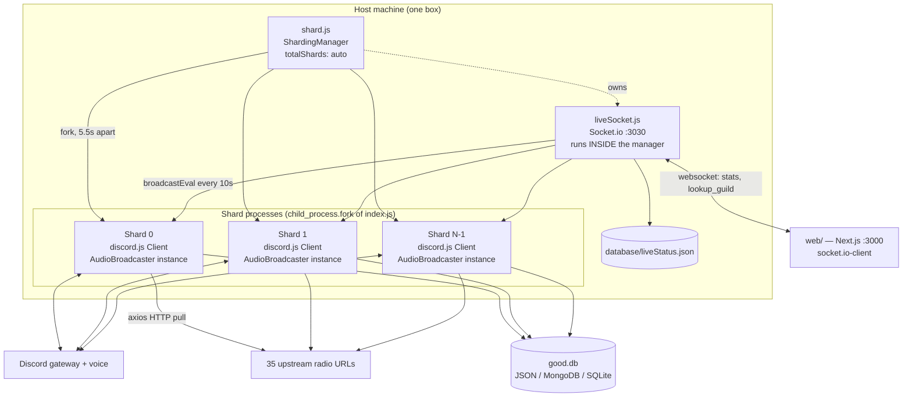
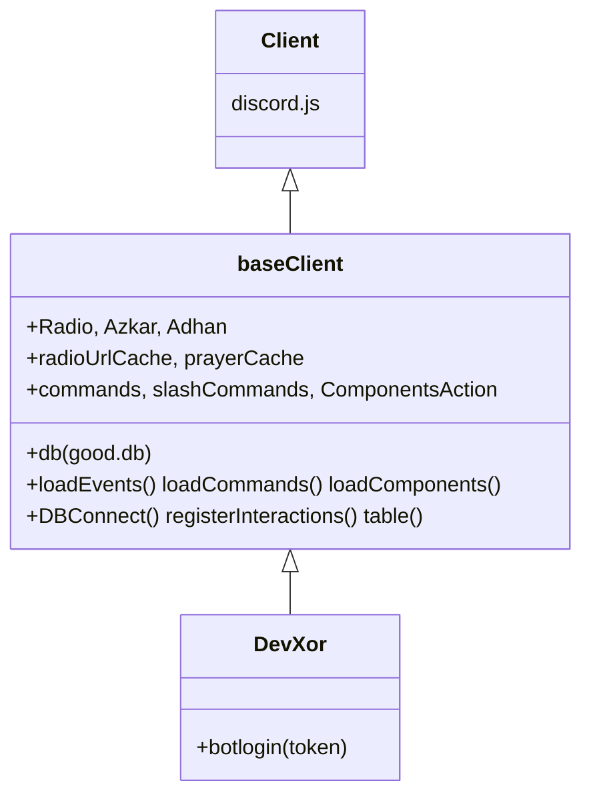
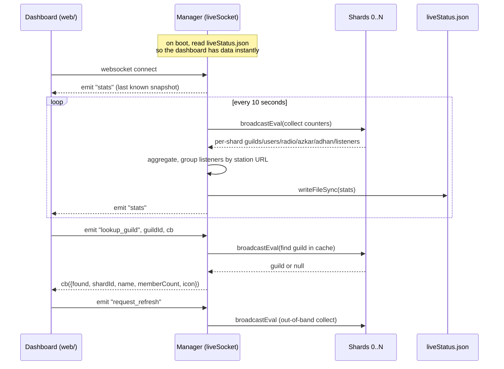
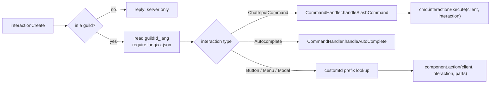
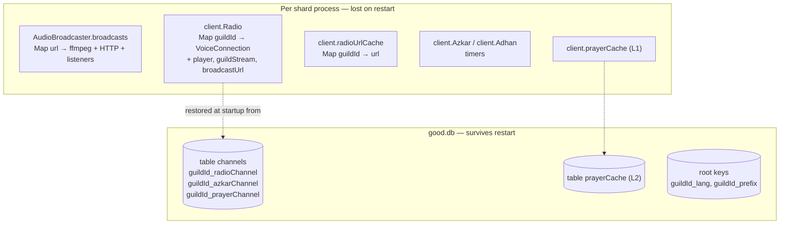

# Architecture

How the Quran Radio bot is put together: processes, who talks to whom, and where state lives.

> Every claim here is traceable to a file and line. Where the code does not answer a
> question (e.g. the real shard count in production), that is stated instead of guessed.

---

## 1. Process topology

Production runs **one `shard.js` manager process** which forks **N shard processes**, each one a
complete Discord client. A single Socket.io server lives in the manager and feeds the Next.js
dashboard.



### `shard.js` — the manager

| Concern | Detail | Evidence |
|---|---|---|
| Entry script forked | `index.js` | `shard.js:15` |
| Shard count | `totalShards: "auto"` — Discord decides | `shard.js:17` |
| Respawn on death | `respawn: true` | `shard.js:18` |
| Spawn pacing | `delay: 5500`, `timeout: 90_000` | `shard.js:52` |
| Windows console suppression | `child_process.fork` is monkey-patched with `windowsHide: true` **before** discord.js is required | `shard.js:7-10` |
| Socket start | only after `manager.spawn()` resolves | `shard.js:52-56` |
| Shutdown | SIGINT/SIGTERM → `respawn = false`, kill each shard, `process.exit` after 3s | `shard.js:62-71` |

The `windowsHide` patch has to run before discord.js loads because discord.js captures its own
reference to `child_process.fork` at require time.

**Note:** `shard.js`'s `shutdown()` kills shard processes only. The ffmpeg children spawned inside
each shard (`AudioBroadcaster.js:95`) are never tracked or killed explicitly — they are expected to
die when their parent's stdin closes. This has not been verified at runtime.

### Shard processes — `index.js`

Each shard is a full `DevXor` client (`index.js:15`). Three things happen before the client exists:

1. `process.env.FFMPEG_PATH = require("ffmpeg-static")` — pins the ffmpeg binary (`index.js:4`).
2. The Amiri font is registered for canvas (`index.js:8`).
3. `EventEmitter.setMaxListeners(999999999)` (`index.js:10`) — this silences Node's
   "possible EventEmitter memory leak" warning globally. See `AUDIO_REPORT.md` §Minor.

**Do not set `shards: "auto"` in the client options.** `ShardingManager` injects
`DISCORD_SHARD_ID` / `DISCORD_TOTAL_SHARDS` and discord.js reads them; setting `"auto"` makes every
shard process connect as *all* shards, so each interaction is handled N times (error 40060). The
warning is recorded in `src/base/baseClient.js:40-42`.

### Class hierarchy



`baseClient` selects the good.db driver from `database_type` (`src/base/baseClient.js:56-61`) and
creates every collection. `DevXor`'s constructor calls the three loaders
(`src/DevXor.js:11-13`); `botlogin()` is invoked from a 2-second `setTimeout` in the entry file
(`index.js:45-47`).

---

## 2. How the pieces communicate

There are exactly four communication channels. No shard ever talks to another shard directly.



| Channel | Mechanism | Evidence |
|---|---|---|
| Manager → shards | `manager.broadcastEval()` | `liveSocket.js:51`, `liveSocket.js:99` |
| Manager → dashboard | Socket.io `stats` event | `liveSocket.js:198` |
| Manager → disk | `fs.writeFileSync` every 10s | `liveSocket.js:197` |
| Dashboard → manager | `lookup_guild` (with ack callback), `request_refresh` | `liveSocket.js:47-77` |
| Shard → Discord | gateway WS + voice UDP | `@discordjs/voice` 0.19.1 |
| Shard → radio source | `axios.get(..., responseType: 'stream')` | `AudioBroadcaster.js:85` |
| Shard → database | good.db, table `channels` | `baseClient.js:146` |

### What `broadcastEval` reads off each shard

`liveSocket.js:99-158` runs inside every shard and reads these client properties directly:

- `c.Radio` — iterated to count guilds and resolve each one's voice channel
- `c.radioUrlCache` — maps guild → station URL
- `c.Azkar`, `c.Adhan` — `.size` only
- `c.guilds.cache`, `c.ws.ping`, `process.uptime()`

**Renaming any of those collections silently breaks the dashboard** — `broadcastEval` serialises a
function to the child, so a typo or rename produces `undefined`, not an error. The code already
guards with `?? new Map()` (`liveSocket.js:112`) and `?? 0`, which means a rename would show as
zeros rather than a crash.

Listener counts are *real humans*: `voiceChannel.members.filter(m => !m.user.bot).size`
(`liveSocket.js:121`). A guild whose voice channel has no humans is counted as `idleRadio`
(`liveSocket.js:124-126`) rather than as a listener.

### Socket configuration

- Port: `process.env.SOCKET_PORT || 3030` (`liveSocket.js:30`)
- CORS origin: `process.env.DASHBOARD_ORIGIN || '*'` (`liveSocket.js:35`) — `GET`/`HEAD` only
- First collect at +8s, then every 10s (`liveSocket.js:88-91`)
- Station URL → human name resolved through `RadioChannels` (`liveSocket.js:24-26`)

### The dashboard (`web/`)

A separate Next.js 15 / React 19 app with its own `package.json` and its own git repository
(`web/.git` exists). It is **not** part of the bot's dependency tree.

| Route / file | Purpose |
|---|---|
| `web/src/app/page.tsx` | landing page |
| `web/src/app/dashboard/page.tsx` | stat tiles |
| `web/src/app/dashboard/shards/page.tsx` | per-shard table |
| `web/src/app/dashboard/broadcasts/page.tsx` | per-station listener counts |
| `web/src/app/api/stats/route.ts` | server-side stats route |
| `web/src/contexts/DashboardContext.tsx` | socket.io-client connection + shared state |

`dashboard/` at the repo root is a separate, older static HTML/Tailwind prototype (prayer-time
lookup page) and is unrelated to the live-status dashboard.

---

## 3. Request flow: a slash command or button press



Component routing splits `customId` on `_` and tries four keys in order
(`src/events/interaction/interactionCreate.js:44`):

1. `parts[0]_parts[1]`
2. `parts[0]_parts[1]_parts[2]`
3. `parts[0]`
4. the whole `customId`

So the component registered as `onRadio_off_radio`
(`src/ComponentsAction/settings/onRadio_off_radio.js:10`) is reached by a customId like
`onRadio_off_radio_<guildId>`, and `action()` receives the split array as its third argument.

**Localization gotcha:** `interactionCreate.js:24` resolves `lang` but never passes it —
`handleSlashCommand(client, interaction)` (`:28`) and `component.action(client, interaction, parts)`
(`:49`) both omit it. Every handler declares a trailing `lang` parameter that is always
`undefined`; files that need translations require `lang/en.json` directly.

---

## 4. Loaders

`src/handlers/index.js` re-exports under names that differ from the filenames:

| Export | File | Loads from |
|---|---|---|
| `EventsLoader` | `EventsLoader.js` | `src/events/` |
| `CommandsLoader` | `CommandLoader.js` | `src/Commands/` |
| `ComponentsLoader` | `ComponentsActionLoader.js` | `src/ComponentsAction/` |
| `CommandHandler` | `Commands.js` | prefix / slash / autocomplete dispatch |

`EventsLoader` is re-entrant: it stores `{name, handler}` per file path in `client.events` and calls
`client.off()` for the previous handler before re-registering
(`src/handlers/EventsLoader.js:27-32`). That is what makes the `/refresh` command safe for *events*.
It is **not** safe for the audio broadcaster — see `AUDIO_REPORT.md` §C2.

---

## 5. State: what lives where



### Database keys

Config rows are **not** at the root — they go through `await client.db.table("channels")`:

| Key (table `channels`) | Purpose |
|---|---|
| `[guildId]_radioChannel` | `channelId`, `url`, `ch` + `msgId` (control message), `enabled` |
| `[guildId]_azkarChannel` | text channel, `msgTimeSend` frequency, categories, roles |
| `[guildId]_prayerChannel` | location/timezone, notification frequency, `enabled` |
| `[guildId]_lang`, `[guildId]_prefix` | per-guild overrides — read off `client.db` **root**, not the table |

Nested writes use the `..` separator, e.g.
``db.set(`${id}_radioChannel..enabled`, false)`` (`joinAndPlayQuran.js:123`).
`db.endsWith("_radioChannel")` retrieves all radio guilds at startup (`ready.js:84`).

### Shard ownership

`ready.js` computes guild→shard ownership itself rather than trusting the client:

```js
Number(BigInt(guildId) >> 22n) % totalShards === shardId   // ready.js:115-117
```

Every restore list is filtered by it (`ready.js:84-86`). Without that filter, all shards would race
over all guilds and delete each other's rows.

---

## 6. Deployment

```bash
pm2 start ecosystem.config.js    # runs shard.js, fork mode, 1 instance
pm2 stop quran
```

`ecosystem.config.js` sets `autorestart: true`, `restart_delay: 5000`, `max_restarts: 10`,
`min_uptime: "10s"`, `kill_timeout: 5000`, logs to `./logs/out.log` and `./logs/error.log`.
There is **no `max_memory_restart`**, so a leaking manager process is never recycled.

`start.vbs` / `stop.vbs` wrap the two pm2 commands with no console window — together with the
Windows ffmpeg binary in `node_modules/ffmpeg-static/ffmpeg.exe`, this suggests the current host is
Windows. The production OS is not stated anywhere in the repo.

---

## Related documents

- [`audio-pipeline.md`](./audio-pipeline.md) — the audio path in detail
- [`startup-restore.md`](./startup-restore.md) — how voice connections come back after a restart
- [`AUDIO_REPORT.md`](./AUDIO_REPORT.md) — risk analysis of the audio subsystem
