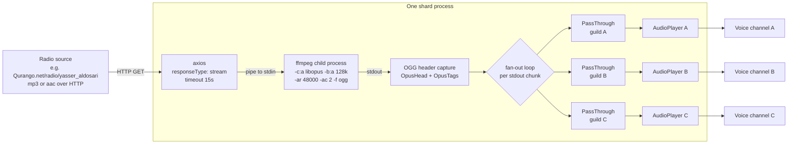
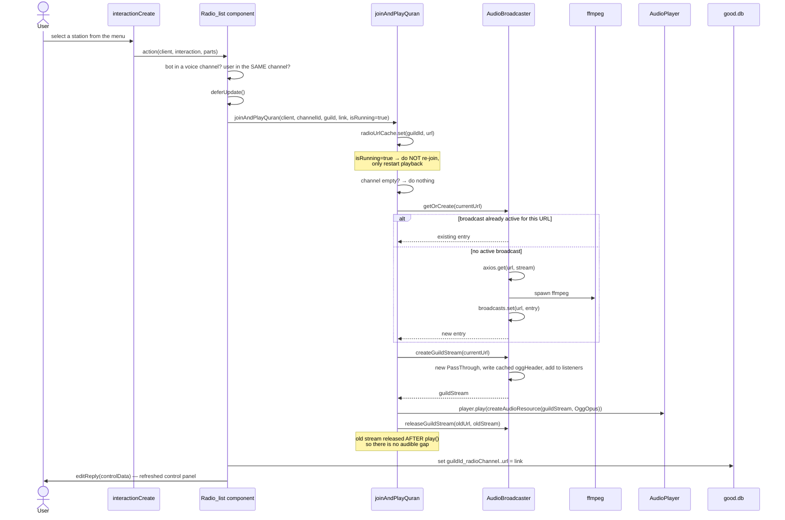
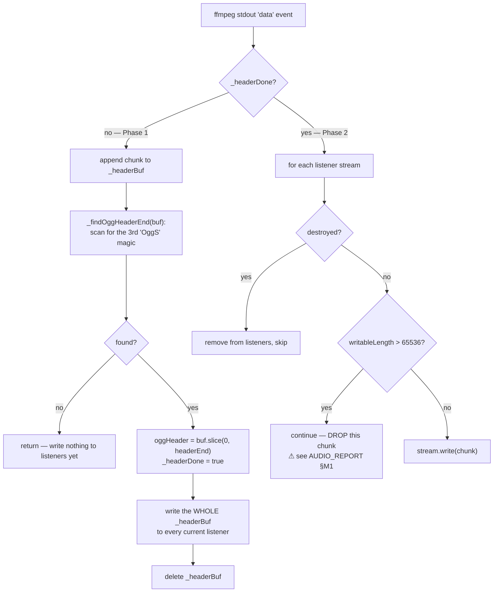
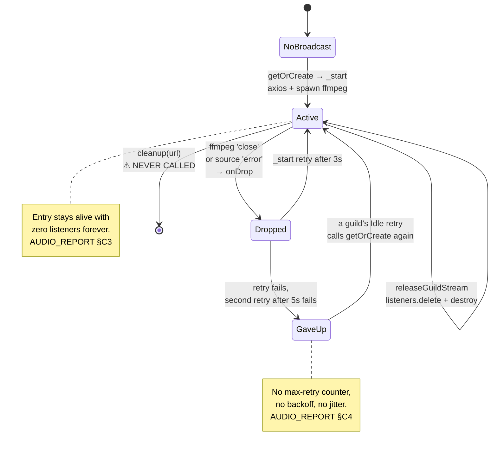
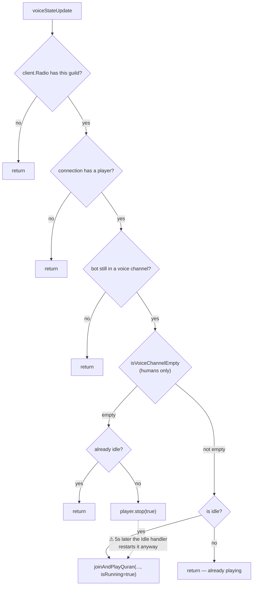

# The audio pipeline

The full journey of sound: from a user picking a station in a Discord menu to Opus packets arriving
in a voice channel — and what happens when any part of it breaks.

> Behavioural risks found along the way are flagged inline with a ⚠ and analysed properly in
> [`AUDIO_REPORT.md`](./AUDIO_REPORT.md).

---

## 1. The shape of it

One HTTP connection and one ffmpeg process **per station URL, per shard process**. Every guild
listening to that station gets its own `PassThrough` fed from that single ffmpeg's stdout.



The design intent, stated at `AudioBroadcaster.js:5-12`, is that 500 guilds on one station cost one
HTTP pull and one encode rather than 500. Within a single shard, that holds. Across shards it does
not — each shard has its own instance (`joinAndPlayQuran.js:8`), so the same station is fetched and
encoded once per shard.

---

## 2. The walkthrough: user picks a station



### Entry points into the pipeline

| Trigger | Call | `isRunning` |
|---|---|---|
| Station picked from menu | `Radio_list.js:33` | `true` |
| Next / previous / random station | `nextChannel.js:35`, `backChannel.js:35`, `randomChannel.js:35` | `true` |
| Radio toggled ON | `onRadio_off_radio.js:33` | `false` (fresh join) |
| Restore after restart | `ready.js:159` | `false` (fresh join) |
| Someone joined an empty channel | `statusManagerRadio.js:27` | `true` |
| Player error recovery | `joinAndPlayQuran.js:160` | `true` |

`isRunning = true` means *restart playback on the existing connection, do not re-join*
(`joinAndPlayQuran.js:69-77`). `isRunning = false` performs `joinVoiceChannel`, creates a new
`AudioPlayer`, and attaches all the event handlers (`joinAndPlayQuran.js:79-99`).

### Permission gates on station switching

Every switch component checks two things before doing anything
(`Radio_list.js:16-23`, same in `nextChannel.js:17-24`):

1. the bot must be in a voice channel;
2. the user must be in **the same** voice channel as the bot.

There is no cooldown and no per-guild lock on these components. ⚠ See `AUDIO_REPORT.md` §M4.

---

## 3. ffmpeg: which binary, and why it exists at all

`index.js:4` resolves the binary at startup and publishes it through the environment:

```js
process.env.FFMPEG_PATH = require("ffmpeg-static");
```

`AudioBroadcaster.js:91` reads it back, falling back to whatever `ffmpeg` is on `PATH`:

```js
const ffmpegBin = process.env.FFMPEG_PATH || 'ffmpeg';
```

The binary currently vendored in this checkout:

| Property | Value |
|---|---|
| npm package | `ffmpeg-static` 5.2.0 |
| pinned release tag | `b6.0` (`node_modules/ffmpeg-static/package.json`) |
| actual binary | `ffmpeg version 6.0-essentials_build-www.gyan.dev` |
| built | 2023, gcc 12.2.0 (MSYS2) |
| licence | `--enable-gpl --enable-version3` |
| platform in this checkout | `ffmpeg.exe`, 81 MB → Windows |
| `libopus` encoder | present (`A....D libopus`) |

`ffmpeg-static` is a convenience wrapper: its `install.js` downloads a prebuilt binary from GitHub
at `npm install` time rather than shipping it inside the tarball. That has consequences for
production — covered in `AUDIO_REPORT.md` §M7.

### Why ffmpeg is in the path at all

The upstream stations serve mp3 or aac (the code never inspects the content type, so this is
inferred from the URLs in `RadioChannels.js`, not verified). Discord needs **Opus at 48 kHz
stereo**. The options were:

1. decode + encode in Node with a native Opus addon (`@discordjs/opus`, `opusscript`);
2. shell out to ffmpeg and have it emit a container Discord's voice library can demux in pure JS.

This codebase chose (2), and the comment at `AudioBroadcaster.js:93-94` says why: emitting **OGG**
means `StreamType.OggOpus` can demux it in pure JavaScript, so no native Opus encoder has to be
built or shipped. The trade is one OS process per station per shard instead of one in-process
encoder.

```
-i pipe:0        read from stdin (the axios stream)
-c:a libopus     encode to Opus
-b:a 128k        128 kbit/s   ⚠ drives per-guild egress — see AUDIO_REPORT §M6
-ar 48000        48 kHz, what Discord requires
-ac 2            stereo
-f ogg           OGG container
-loglevel error  only errors on stderr
pipe:1           write to stdout
```

Flags that are **not** present and might matter: no `-nostdin`, no `-vn`, no `-flush_packets 1` or
`-fflags nobuffer` (so ffmpeg may add output buffering latency), and no ffmpeg-level
`-reconnect` flags — reconnection is entirely axios's and the broadcaster's job because the input
is a pipe, not a URL.

---

## 4. OGG header capture and replay

This is the cleverest part of the file, and it exists to solve a real problem: **a guild that joins
30 minutes into a broadcast has missed the stream's header pages and cannot decode anything.**

An OGG Opus stream begins with two mandatory header pages — `OpusHead` (channel count, sample
rate, pre-skip) and `OpusTags` (metadata) — followed by audio pages. A decoder that starts reading
at an arbitrary audio page has no idea how to interpret it.

So the broadcaster runs in two phases.



**Phase 1 — capture** (`AudioBroadcaster.js:122-136`). Chunks accumulate in `entry._headerBuf`.
Nothing is sent to listeners yet (`:135`). `_findOggHeaderEnd` (`:173-185`) scans for the literal
bytes `OggS` and returns the offset of the **third** occurrence, on the reasoning that pages 1 and 2
are the headers and page 3 is the first audio page. Once found, `entry.oggHeader` holds exactly the
two header pages (`:126`), and any guild already waiting gets the whole buffer replayed (`:129-131`).

**Phase 2 — fan-out** (`AudioBroadcaster.js:138-143`). Each chunk is written to every live listener.

**The replay** is at `createGuildStream` (`AudioBroadcaster.js:31-47`): a brand-new `PassThrough` is
created, the cached header is written into it *first* (`:38`), and only then is it added to
`entry.listeners` (`:40`). The guild therefore sees a valid stream from byte zero: `OpusHead`,
`OpusTags`, then live audio from wherever the broadcast currently is.

⚠ Two caveats on the header logic, both in `AUDIO_REPORT.md` §M2: `indexOf('OggS')` does not
validate page structure (the four bytes can occur inside an Opus payload), and the "exactly two
header pages" assumption breaks if `OpusTags` metadata ever spans more than one page.

---

## 5. The 64 KB skip

```js
if (stream.writableLength > 65_536) continue;   // AudioBroadcaster.js:141
```

The intent — stated in the comment on that line — is that this is **live radio**: a consumer that
has fallen behind should lose audio rather than accumulate an ever-growing backlog that it would
then play at the wrong wall-clock time. A guild whose voice connection has stalled (network
hiccup, Discord-side delay) would otherwise grow an unbounded buffer inside the `PassThrough`.

The streams are created with `highWaterMark: 0` (`AudioBroadcaster.js:35`), which is unusual: it
means `write()` always reports backpressure, so Node never treats the buffer as "fine". The
threshold being checked is `writableLength`, the bytes currently sitting unread in the writable
side.

**What dropping actually does.** The skip discards a whole ffmpeg stdout chunk from the middle of a
byte stream. OGG is a framed container: a page has a 27-byte header, a capture pattern, a segment
table, a CRC and a granule position. ffmpeg's stdout chunks are pipe-sized reads with no relation
to page boundaries, so a dropped chunk almost always removes bytes from *inside* a page and leaves
the listener's byte stream spliced together at an arbitrary offset.

The demuxer behind `StreamType.OggOpus` must then resynchronise on the next `OggS` capture pattern,
discarding the partial page. Expected symptom: an audible glitch or short dropout, possibly a
demuxer error that surfaces as an `AudioPlayer` `'error'` and triggers the 7-second rebuild at
`joinAndPlayQuran.js:154-165`. At 128 kbit/s, 64 KB is roughly **4 seconds** of audio, so by the
time the threshold trips the listener is already 4 seconds behind.

⚠ A cleaner approach would be to drop *whole pages* or simply destroy and rebuild the guild stream
rather than splice the byte stream. See `AUDIO_REPORT.md` §M1.

---

## 6. Lifecycle: create, release, cleanup



### The three teardown paths

| Function | What it does | Called from |
|---|---|---|
| `releaseGuildStream(url, stream)` | removes one stream from `listeners`, destroys it (`:49-54`) | `joinAndPlayQuran.js:60`, `:174` |
| `cleanup(url)` | destroys every listener, kills ffmpeg + HTTP, removes the map entry (`:56-63`) | **nothing** |
| `_destroyEntry(entry)` | `active = false`, destroy source, `SIGKILL` ffmpeg (`:187-191`) | `_start`, `onDrop` |

`cleanupBroadcast(url)` is exported at `joinAndPlayQuran.js:179` and `:182`, and a repo-wide grep
finds **no caller**. ⚠ This means a broadcast that loses its last listener keeps its ffmpeg process
and HTTP connection running until the shard process exits — `AUDIO_REPORT.md` §C3.

### Releasing a guild's stream

`_releaseStream(conn)` (`joinAndPlayQuran.js:172-176`) deliberately reads the URL **from the
connection object** rather than from a closure, because the guild may have switched stations since
the handler was attached.

In `playBroadcastAudio`, the ordering is deliberate and documented at `joinAndPlayQuran.js:37-39`:
the old stream is snapshotted, the new one is created and handed to `player.play()`, and only then
is the old one released (`:60`). Releasing first would close the underlying stream, bounce the
player through `Idle`, and produce an audible gap.

The same function also re-reads the URL from `client.radioUrlCache` on every call
(`joinAndPlayQuran.js:32`) specifically so that a stale event handler from a previous station cannot
restart the station the user has already switched away from.

### Reconnect behaviour

```js
const onDrop = () => {
  if (!entry.active) return;                       // AudioBroadcaster.js:147
  this._destroyEntry(entry);
  setTimeout(() => this._start(url).catch(err => {
    setTimeout(() => this._start(url).catch(() => {}), 5_000);   // :152
  }), 3_000);                                      // :150
};
ffmpeg.on('close', onDrop);                        // :156
response.data.on('error', onDrop);                 // :157
```

Two triggers (ffmpeg exits, or the HTTP stream errors), both funnelled into `onDrop`. The
`if (!entry.active) return` guard is what stops the two triggers from firing the same reconnect
twice, since `_destroyEntry` sets `active = false` before anything else.

On restart, `_start` copies the previous listener set forward as **survivors**
(`AudioBroadcaster.js:80`, logged as "guilds restored" at `:164`), so guilds keep their existing
`PassThrough` objects across a source reconnect and do not need to rebuild their audio resources.

⚠ Three problems here, all in `AUDIO_REPORT.md`: there is no stall detection at all (a source that
goes quiet without closing the socket never triggers `onDrop` — §C1), the retry chain gives up after
two attempts and leaves per-guild loops to hammer the dead host forever (§C4), and concurrent
`getOrCreate` calls are not deduplicated (§C7).

---

## 7. AudioPlayer events

Attached once per fresh join (`joinAndPlayQuran.js:139-165`):

| Event | Handler | Behaviour |
|---|---|---|
| `Playing` | `:139-141` | log only |
| `Idle` | `:143-152` | wait 5s; if the player is *still* Idle, call `playBroadcastAudio` again |
| `error` | `:154-165` | release the stream, wait 7s, re-enter `joinAndPlayQuran` with `isRunning = true` |

The `Idle` handler's re-check at `:149` is a guard against a station switch having already started
playback during the 5-second wait.

⚠ The `Idle` handler does **not** check whether the voice channel is empty. Combined with
`statusManagerRadio`, that means the "stop when nobody is listening" feature only pauses audio for
five seconds — `AUDIO_REPORT.md` §C5.

And on the connection itself (`joinAndPlayQuran.js:114-136`): a `stateChange` to `disconnected`
marks the guild disabled in the DB, refreshes the control message, releases the stream, stops the
player and deletes the `client.Radio` entry.

---

## 8. `statusManagerRadio` — not paying for empty channels

`src/events/voice/statusManagerRadio.js` listens on `voiceStateUpdate` and is the mechanism meant to
keep the bot from encoding audio nobody can hear.



`isVoiceChannelEmpty` (`src/utils/class/voice.js:14-22`) filters out bots, so a channel containing
only the radio bot counts as empty. The `isMeChannel = true` argument
(`statusManagerRadio.js:20`) makes it inspect the bot's own channel rather than the channel in the
event.

The guild's `PassThrough` is **not** released when playback stops at `statusManagerRadio.js:22` —
only `player.stop(true)` is called. Whether the stream is destroyed depends on
`@discordjs/voice` tearing down the resource's underlying stream on stop, which this analysis has
not verified at runtime. If it does, `createGuildStream`'s `'close'` handler
(`AudioBroadcaster.js:43`) removes it from `listeners`; if it does not, the stream stays registered
and keeps being written to until it crosses the 64 KB threshold and is skipped forever.

---

## 9. Where the numbers come from

| Quantity | Value | Source |
|---|---|---|
| Distinct station URLs | 35 (all unique) | `RadioChannels.js` |
| Station groups | 23 `quran`, 4 `any`, 3 `tafseer`, 2 `azkar`, 2 `ebthalat`, 1 `siyra` | `RadioChannels.js` |
| ffmpeg processes per shard | one per **distinct URL in use on that shard** | `AudioBroadcaster.js:16`, `joinAndPlayQuran.js:8` |
| HTTP pulls per shard | same as ffmpeg count | `AudioBroadcaster.js:85` |
| Encode bitrate | 128 kbit/s stereo | `AudioBroadcaster.js:98` |
| Lag threshold | 65 536 bytes ≈ 4s of audio | `AudioBroadcaster.js:141` |
| Source read timeout | 15 s (headers only) | `AudioBroadcaster.js:85` |
| Reconnect delays | 3 s, then 5 s, then give up | `AudioBroadcaster.js:150-152` |
| Player idle retry | 5 s, unlimited | `joinAndPlayQuran.js:151` |
| Player error retry | 7 s, unlimited | `joinAndPlayQuran.js:164` |

`ControlData.js:11-15` splits the station list into two select menus — `group: "quran"` in one,
everything else in the other — because Discord allows at most 25 options per menu and there are 23
Quran stations.

---

## Related documents

- [`architecture.md`](./architecture.md) — processes and communication
- [`startup-restore.md`](./startup-restore.md) — restoring connections after a restart
- [`AUDIO_REPORT.md`](./AUDIO_REPORT.md) — risks and weaknesses in this pipeline
