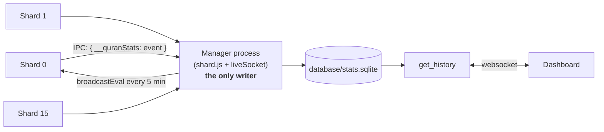

# Dashboard statistics API

Everything a dashboard developer needs to build the statistics page without
asking anyone. Covers the stats that are **stored**, the Socket.io requests that
**serve** them, and the exact response shapes.

The live-status API (the `stats` event pushed every 10 seconds) is unchanged and
documented in [`architecture.md`](./architecture.md) §2. This file is only about
**history**.

---

## 1. Where the data lives



**One writer, by design.** Sixteen shards writing one SQLite file would contend
on every insert, so shards never touch it: they send events to the manager over
the sharding IPC and the manager performs the write. An unsharded `npm start` is
itself the only process, so it writes directly and the invariant still holds.

**Not in the main database.** Production (`shard.js` → `index.js`) configures
good.db with `database_type: "JSON"`, a driver that rewrites the whole file on
every write and keeps the dataset in memory. A time series there would grow the
bot's live configuration file without bound. Stats are therefore a separate
SQLite file — `better-sqlite3` is already a dependency (via good.db), needs no
server, and `GROUP BY` on a time bucket is one query instead of manual work.

### Retention

| Data | Kept | Variable |
|---|---|---|
| Raw events and 5-minute snapshots | **90 days** | `STATS_RAW_RETENTION_DAYS` |
| Hourly rollups | **365 days** | `STATS_HOURLY_RETENTION_DAYS` |

Rollup and pruning run every 6 hours (`STATS_CLEANUP_INTERVAL_MS`). Raw rows are
folded into hourly buckets *before* they are deleted, so a query older than 90
days still returns data — at hourly resolution.

---

## 2. What is stored

### Guild events

| Field | Notes |
|---|---|
| `kind` | `guild_join` or `guild_leave` |
| `guild_id`, `guild_name`, `member_count` | at the moment of the event |
| `actor_id` | **who added the bot**, from the audit log's `BotAdd` entry |
| `at` | epoch ms |

`actor_id` requires **View Audit Log**, which most servers do not grant. It is
`null` when unavailable and the event is still recorded — a missing permission
never costs the join.

### Playback events

| Field | Notes |
|---|---|
| `kind` | `radio_on`, `radio_off`, `station_switch`, `radio_error` |
| `guild_id` | |
| `station` | stream URL |
| `actor_id` | the user who pressed the button; `null` for events the player raised itself |
| `reason` | failure reason, `radio_error` only |

### Language events

`kind: language_set`, with `detail` as JSON:

```json
{ "lang": "ar", "source": "prompt" }
```

`source` is one of `prompt` (the first-use tip) or `command` (`/lang`). Those
are the only two ways a language is ever set — nothing is detected or applied
automatically, so there is no `default`, `locale` or `quick` source.

### Snapshots — every 5 minutes

Taken from exactly what `liveSocket._collect()` already gathers, so a snapshot
can never disagree with the live dashboard: total guilds and users, radio guilds,
real listeners, `idleRadio`, active broadcasts, shard count, audio mode, the
audio server's ffmpeg count, per-shard totals (JSON), listeners/guilds/idle per
station, and guilds per language.

---

## 3. Requests

### `get_history`

```js
socket.emit('get_history', { metric: 'servers', from: Date.now() - 7*864e5, to: Date.now() }, (res) => { ... });
```

| Field | Required | Notes |
|---|---|---|
| `metric` | yes | see the table below |
| `from`, `to` | no | epoch ms; defaults to the last 24 hours |
| `bucket` | no | bucket width in ms; omit to let the server choose |

**Metrics:** `servers`, `users`, `radio`, `idle_radio`, `listeners`,
`broadcasts`, `ffmpeg`, plus `events`, `stations` and `languages`.

**Automatic bucket sizes** — chosen to keep any range at roughly 60–200 points:

| Range | Bucket |
|---|---|
| ≤ 6 hours | 5 minutes |
| ≤ 2 days | 1 hour |
| ≤ 14 days | 6 hours |
| ≤ 90 days | 1 day |
| longer | 7 days |

**Errors:** `{ error: 'stats_unavailable' }` (no store — e.g. the bot is running
unsharded without one), `'bad_range'` (`to <= from`), `'range_too_wide'`
(over ~400 days), `'unknown_metric'`, `'query_failed'`.

### `get_stats_info`

```js
socket.emit('get_stats_info', (info) => { ... });
```

Row counts, database size and the retention settings. Useful for a diagnostics
panel.

It does **not** return the database path. An absolute path describes the
machine the bot runs on (drive, user, directory names), and everything this
socket returns is readable by anyone who can connect to the port — see §5.

---

## 4. Response shapes

### Numeric series — `servers`, `users`, `radio`, `idle_radio`, `listeners`, `broadcasts`, `ffmpeg`

```json
{
  "metric": "servers",
  "from": 1793400000000,
  "to": 1793486400000,
  "bucket": 3600000,
  "bucketLabel": "1h",
  "points": [
    { "t": 1793400000000, "value": 14980.5, "min": 14975, "max": 14986 },
    { "t": 1793403600000, "value": 15002.1, "min": 14990, "max": 15011 }
  ]
}
```

`value` is the bucket average (2 decimal places); `min`/`max` are the extremes
within it. `value` may be `null` for a bucket with no data — leave a gap rather
than drawing through it.

### `events`

```json
{
  "metric": "events",
  "from": 1793400000000, "to": 1793486400000,
  "bucket": 3600000, "bucketLabel": "1h",
  "points": [
    { "t": 1793400000000, "counts": { "guild_join": 12, "guild_leave": 3, "radio_on": 48 } },
    { "t": 1793403600000, "counts": { "radio_on": 51, "station_switch": 9, "radio_error": 1 } }
  ]
}
```

A kind absent from `counts` means zero in that bucket.

### `stations`

Aggregated over the whole range, not bucketed — highest average listeners first.

```json
{
  "metric": "stations",
  "from": 1793400000000, "to": 1793486400000,
  "stations": [
    { "id": "9f2b41c0a7de", "url": "https://Qurango.net/radio/yasser_aldosari",
      "name": "إذاعة ياسر الدوسري",
      "avgListeners": 412.75, "peakListeners": 980, "avgGuilds": 120.5 }
  ]
}
```

`id` is a stable 12-character hash of the stream URL — use it as the React key
and for grouping, not `url`.

`url` is **origin + path only; the query string is stripped**. One station in
`RadioChannels.js` carries a provider token in its query (`?rj-tok=…`), so no
query string is published for any of them. The full URL is still stored and is
what the bot plays; it just never leaves the manager process. If you need to
match a history row against a live `broadcasts` entry, compare `id`.

### `languages`

```json
{
  "metric": "languages",
  "from": 1793400000000, "to": 1793486400000,
  "bucket": 3600000, "bucketLabel": "1h",
  "points": [
    { "t": 1793400000000, "langs": { "ar": 9120, "en": 5880 } }
  ]
}
```

Counts guilds with a **saved** choice. A guild that has never chosen appears in
neither bucket (it is simply on English), so `ar + en` is normally below the
total server count — the difference is the servers that have not picked a
language.

### `get_stats_info`

```json
{
  "bytes": 48234496,
  "events": 412903, "snapshots": 25920, "stationSamples": 740160,
  "langSamples": 51840, "hourly": 61320,
  "rawRetentionDays": 90, "hourlyRetentionDays": 365
}
```

---

## 5. Privacy

The history endpoints return **totals and per-station numbers only**. No guild
ids, guild names, user ids or per-guild rows ever leave the store through
`get_history` — a regression test asserts the responses contain none of those
fields. Guild and actor ids exist in the `events` table for operational
forensics, and are reachable only by someone with filesystem access.

### Nothing about the host is published

Every outbound payload is shaped by one block of helpers at the top of
`liveSocket.js` (`_publicStation`, `_publicAudioServer`, `_publicHistory`), so a
new field has to be added there deliberately before it can reach a client.
`tests/socket-leak.test.js` fails if any payload contains a drive letter, a
backslash, a `/home`-style path, a `.sqlite` filename, a loopback address, a
`host:port`, or a key ending in `pid`.

Fields that **used** to be published and are now gone:

| Removed | Was in | Why |
|---|---|---|
| `file` | `get_stats_info` | absolute path of the stats database |
| `audioServer.url` | the `stats` event | internal host and port of the audio server |
| `audioServer.health.stations[].ffmpegPid` | the `stats` event | process ids on the host |
| query strings on every station `url` | `stats`, `get_history` | one station's URL carries a provider token |

`audioServer.health.totals.ffmpeg` is kept — a **count** of ffmpeg processes is
a useful chart and says nothing about the host.

Handler errors reply with a short code (`query_failed`) and log the real message
on the server; no exception text or stack trace is ever sent to a client.

### Who can connect

**`DASHBOARD_ORIGIN` is not access control.** It sets the Socket.io CORS origin,
which only constrains browsers — a script, `curl` or any Socket.io client
ignores it entirely.

`http.listen(port)` is called with no host argument, so the socket binds
**`0.0.0.0`** — every interface, not just loopback. On a machine whose
`SOCKET_PORT` (default 3030) is reachable from the internet, anyone can connect
and call every handler with no authentication:

| Request | What an unauthenticated caller gets | Risk |
|---|---|---|
| `stats` (pushed on connect) | total guilds, users, listeners, per-shard guild counts, ping, uptime, which stations are playing | business metrics; no user data |
| `get_history` | the full time series above, up to a year back | same, historical |
| `get_stats_info` | row counts and database size | negligible |
| `lookup_guild` | **name, member count and icon of any guild id**, plus which shard holds it | the one real concern: it confirms the bot is in a given server and names it. Guild ids are not secret, so this is enumerable |
| `request_refresh` | triggers a `broadcastEval` across all shards | cheap denial-of-service: unthrottled, so a loop can keep every shard busy |

Authentication is deliberately **not** implemented yet. Until it is, the fix is
network-level: bind to loopback (`http.listen(port, '127.0.0.1')`) and reach the
dashboard through a reverse proxy, or firewall the port.

---

## 6. Example: a 7-day listeners chart

```js
const socket = io('http://127.0.0.1:3030');

socket.emit('get_history', {
  metric: 'listeners',
  from: Date.now() - 7 * 24 * 60 * 60 * 1000,
  to: Date.now(),
}, (res) => {
  if (res.error) return console.error(res.error);
  const series = res.points.map((p) => ({ x: new Date(p.t), y: p.value }));
  // res.bucketLabel is '6h' for a 7-day range — label the axis with it.
});
```

---

## Related

- [`architecture.md`](./architecture.md) — processes, the live `stats` event
- [`audio-pipeline.md`](./audio-pipeline.md) — what `ffmpeg` and `broadcasts` mean
- [`AUDIO_REPORT.md`](./AUDIO_REPORT.md) — why `idleRadio` is worth charting
