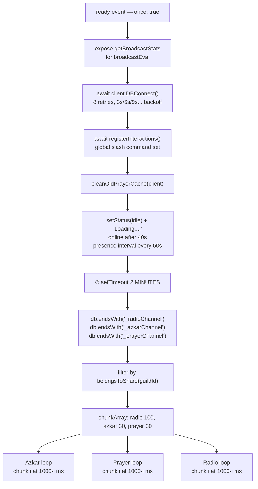
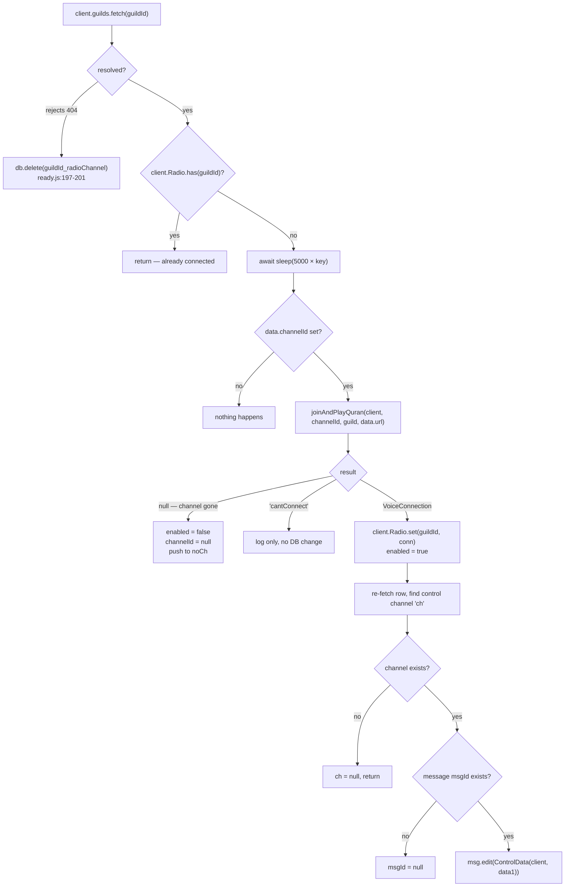

# Startup restore

How `src/events/client/ready.js` brings voice connections, Azkar timers and prayer schedules back
after a restart — and how long that actually takes.

---

## 1. Why this is the hardest part of the bot

Voice connections are pure runtime state. `client.Radio` lives in a shard process's memory
(`src/base/baseClient.js:66`) and dies with it. The only durable record that a guild wanted radio is
its `[guildId]_radioChannel` row in the database. So on every restart each shard has to read its
share of those rows and re-join potentially thousands of voice channels — without tripping Discord's
rate limits and without two shards fighting over the same guild.

---

## 2. The sequence



`once: true` at `ready.js:16` is load-bearing. The comment on that line says it directly: re-running
on reconnect causes duplicate DB connections and stacked timers. A reconnect must not re-enter this
function.

### Before the wait

| Step | Evidence |
|---|---|
| Expose broadcaster stats for the dashboard | `ready.js:23` |
| `DBConnect()` — up to 8 attempts, delay `3000 × attempt` | `ready.js:25`, `baseClient.js:120-140` |
| Register slash commands globally | `ready.js:26` |
| Clean stale prayer cache | `ready.js:27` |
| Presence set to idle + "Loading....", online after 40s | `ready.js:38-40` |
| Presence counters refresh every 60s via `broadcastEval` | `ready.js:41-70` |

Only `MONGODB` and `MySQL` actually connect — `DBConnect` returns early for JSON and SQLite
(`baseClient.js:121-124`).

### Shard ownership

Every shard runs this same `ready` handler, so each must process **only its own guilds**:

```js
const shardId     = client.shard?.ids[0] ?? 0;          // ready.js:115
const totalShards = client.shard?.count ?? 1;           // ready.js:116
const belongsToShard = (guildId) =>
  Number(BigInt(guildId) >> 22n) % totalShards === shardId;   // ready.js:117
```

This is Discord's standard snowflake sharding formula and it is applied to all three restore lists
(`ready.js:84-86`). The comment at `ready.js:111-113` explains the stakes: without the filter, all
shards race to process every guild, producing duplicate connections and false deletions — a shard
that doesn't own a guild can't fetch it, would get a 404, and would **delete the row**
(`ready.js:197-201`).

### The two-minute wait

```js
setTimeout(async () => { /* ... all restore work ... */ }, 2 * 60 * 1000);  // ready.js:81, 231
```

The comment at `ready.js:79-80` gives the reason: let the database connection and the Discord
gateway stabilise before doing heavy work. Note this is two minutes **per shard, counted from that
shard's own ready event** — and shards are spawned 5.5 seconds apart (`shard.js:52`), so shard 14's
clock starts ~77 seconds after shard 0's.

---

## 3. Chunking and timing

```js
let chunkedRadio  = chunkArray(RadioChannels, 100);   // ready.js:91
let chunkedAzkar  = chunkArray(AzkarChannels, 30);    // ready.js:92
let chunkedPrayer = chunkArray(PrayerChannels, 30);   // ready.js:93
```

`chunkArray` is a plain slice-based split (`src/utils/class/utils.js:157-163`).

### The radio loop — the important one

```js
for (let i = 0; i < chunkedRadio.length; i++) {           // ready.js:147
  setTimeout(async () => {                                 // ready.js:149 — chunk i at 1000·i ms
    for (let [key, data] of chunkedRadio[i].entries()) {   // ready.js:151
      client.guilds.fetch(data.guildId).then(async guild => {   // ready.js:153 — NOT awaited
        if (client.Radio.has(data.guildId)) return;        // ready.js:157
        await sleep(5000 * key);                           // ready.js:158 — key is 0..99
        if (data?.channelId) joinAndPlayQuran(...)          // ready.js:159
```

Two details decide the whole timing profile:

1. **The inner loop does not await.** `client.guilds.fetch(...).then(...)` at `ready.js:153` is
   fire-and-forget, so all 100 entries of a chunk start their async chains immediately.
2. **The stagger is per-index, not cumulative.** `sleep(5000 * key)` at `ready.js:158` uses the
   entry's index *within its chunk*, so entry 0 waits 0 s, entry 50 waits 250 s and entry 99 waits
   **495 s**.

So a guild at chunk `i`, index `k` joins at roughly:

```
T_join  ≈  120 s  +  i × 1 s  +  k × 5 s        (+ guild fetch latency)
```



```mermaid
gantt
    title Radio restore timeline, one shard with 1,000 radio guilds (10 chunks)
    dateFormat X
    axisFormat %Ss

    section Pre-restore
    shard ready to restore kickoff (2 min wait)   :0, 120

    section Chunk launch (1s apart)
    chunk 0 timer fires        :milestone, 120, 0
    chunk 9 timer fires        :milestone, 129, 0

    section Joins (index stagger 5s)
    index 0 of every chunk     :120, 10
    index 49 of every chunk    :365, 10
    index 99 of every chunk    :615, 10
```

### Real numbers

Wall-clock to the **last** guild rejoining:

```
Total ≈ 120 s  +  (chunks − 1) s  +  495 s
```

| Scenario | Radio guilds/shard | Chunks | Last join | Joins per 5 s window |
|---|---|---|---|---|
| 15,000 guilds / 15 shards | 1,000 | 10 | ≈ **10 min 24 s** | 10 (2/s) |
| 15,000 guilds / 8 shards | 1,875 | 19 | ≈ **10 min 33 s** | 19 (3.8/s) |
| 15,000 guilds, single process | 15,000 | 150 | ≈ **12 min 44 s** | 150 (30/s) |
| 500 guilds, one shard | 500 | 5 | ≈ **10 min 19 s** | 5 (1/s) |

Those figures assume every row carries a `channelId` and that `guilds.fetch` latency is negligible.
They also assume all radio guilds are evenly distributed across shards, which snowflake sharding
approximates but does not guarantee.

**Two consequences worth internalising:**

- **The duration is almost fixed at ~10.5 minutes.** It is dominated by the `5000 × 99 = 495 s`
  within-chunk stagger, not by how many guilds there are. A bot with 500 radio guilds takes
  essentially as long as one with 15,000.
- **Chunking increases concurrency instead of spreading it.** Because chunk timers are 1 second
  apart while the inner stagger is 5 seconds, every chunk contributes one join per 5-second window.
  More guilds → more chunks → a *higher join rate*, not a longer runway. Doubling the guild count
  doubles the peak join rate. This is the opposite of what chunking is usually for, and it is
  analysed as a risk in [`AUDIO_REPORT.md`](./AUDIO_REPORT.md) §M3.

### The azkar and prayer loops

These behave differently because their inner loop **does** await
(`ready.js:99-115` and `:125-141`):

```js
for (let data of chunkedAzkar[i]) {
  let guild = await client.guilds.fetch(data.guildId).catch(() => null);
  if (data) { await sleep(1000); if (data?.msgTimeSend) await sendAzkar(client, guild, data); }
}
```

Each chunk of 30 is processed strictly sequentially with a 1-second sleep per guild, so one chunk
takes **at least 30 seconds**. But chunks are launched only 1 second apart (`ready.js:116`), so they
overlap massively: with 1,875 azkar guilds there are 63 chunks, all launched within 63 seconds, each
grinding through its own 30 guilds. Effective behaviour is ~63 parallel sequential workers finishing
in roughly 90–110 seconds total, not 63 × 30 s.

---

## 4. Per-guild restore logic



| Outcome | DB effect | Evidence |
|---|---|---|
| Guild fetch 404 | row deleted after `1000 × i` ms | `ready.js:197-201` |
| `joinAndPlayQuran` → `null` (channel missing) | `enabled = false`, `channelId = null` | `ready.js:161-167` |
| → `"cantConnect"` | none — logged only | `ready.js:168-171` |
| → connection | `client.Radio.set`, `enabled = true` after `100 × i` ms | `ready.js:173-176` |
| Control channel missing | `ch = null` | `ready.js:181-186` |
| Control message missing | `msgId = null` | `ready.js:188-192` |
| Control message found | edited with a fresh `ControlData` panel | `ready.js:193` |

### Two behaviours worth knowing

**The `enabled` flag is ignored on restore.** The guard at `ready.js:159` is
`if (data?.channelId)` — it never checks `data.enabled`. The older, commented-out implementation
directly below *did* check it (`ready.js:205`: `if (data.enabled)`). The live code therefore starts
radio in every guild that has ever configured a channel, including guilds that deliberately turned
it off, and then writes `enabled = true` back to the database at `ready.js:175`. A guild's "off"
choice does not survive a restart. Analysed as §C6 in [`AUDIO_REPORT.md`](./AUDIO_REPORT.md).

**The duplicate-connection guard runs too early.** `client.Radio.has()` is checked at
`ready.js:157`, *before* a sleep that can last up to 495 seconds (`:158`). During that window a user
can press the ON button (`onRadio_off_radio.js:33`) and establish a connection; the restore then
proceeds anyway. See §M4.

`noCh` (`ready.js:90`) collects failed rows at `:165` but is never read afterwards — leftover
debugging.

---

## 5. What is *not* restored

| State | Restored? | Note |
|---|---|---|
| Voice connections | yes | from `[guildId]_radioChannel` |
| Selected station per guild | yes | `data.url`, reseeded into `radioUrlCache` at `joinAndPlayQuran.js:18` |
| Azkar timers | yes | `sendAzkar` re-arms the `setTimeout` chain |
| Prayer schedules | yes | `SendAdhan`, with the prayer cache warmed |
| **Broadcaster state** | no | every shard starts with an empty `broadcasts` Map — ffmpeg processes are respawned on demand as guilds rejoin |
| `client.prayerCache` (L1) | partially | rebuilt from the `prayerCache` DB table on demand |

Because the broadcaster is rebuilt lazily, the *first* guild to rejoin a given station pays for the
`axios.get` + ffmpeg spawn, and everyone after it reuses it. With joins arriving every 5 seconds,
the 35 possible broadcasts come up gradually rather than all at once — which is the one place the
staggering genuinely helps.

---

## 6. Interaction with `respawn: true`

`shard.js:18` sets `respawn: true`. If a shard dies, the manager forks a replacement, which runs
`ready` again and therefore waits another 2 minutes before restoring **that shard's** guilds. Those
guilds are without audio for at least that long.

`shard.js:62-71`'s shutdown path sets `respawn = false` and kills each shard, then exits after 3
seconds. `ecosystem.config.js` gives pm2 `kill_timeout: 5000` and `max_restarts: 10` — after ten
manager crashes within `min_uptime` pm2 stops trying altogether.

---

## Related documents

- [`architecture.md`](./architecture.md) — processes and communication
- [`audio-pipeline.md`](./audio-pipeline.md) — what happens once a connection exists
- [`AUDIO_REPORT.md`](./AUDIO_REPORT.md) — risks, including the restore-timing analysis
